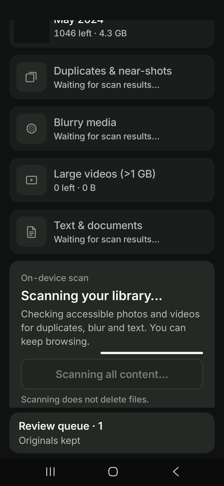
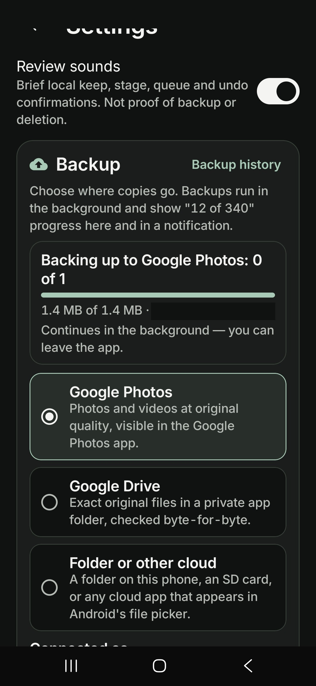
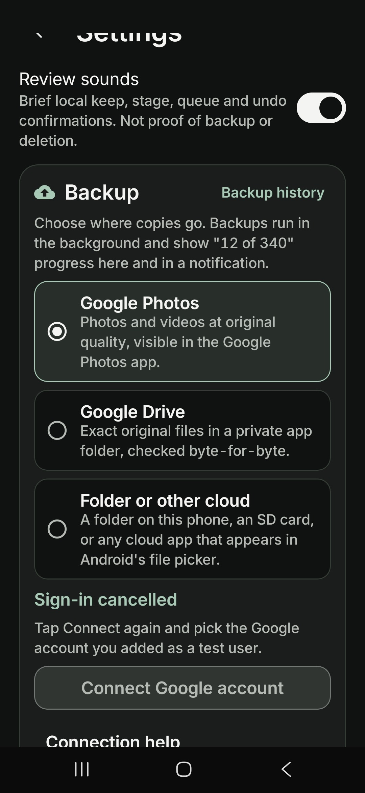
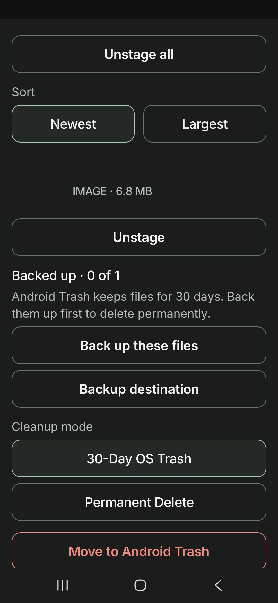
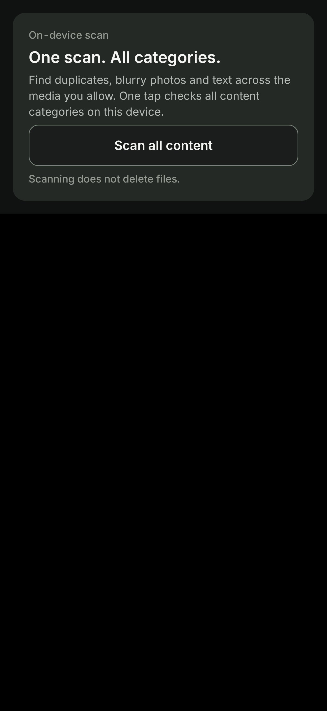
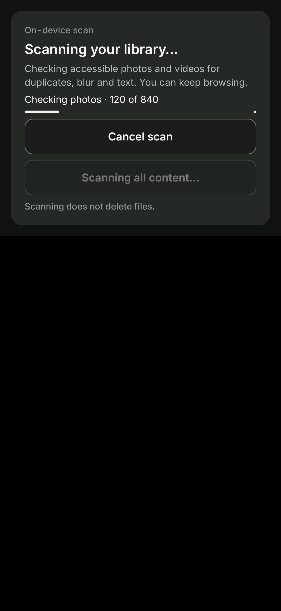
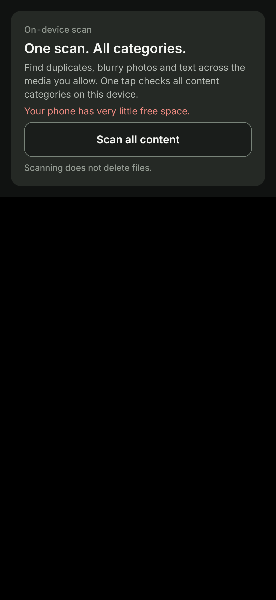
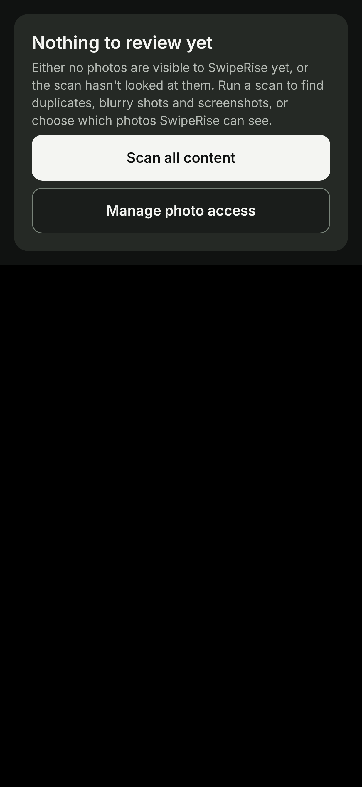

# SwipeRise

Android photo review and staging app. Review your photo library one card at a time: swipe left to stage, right to keep, or up to archive to Photos in the Play build.

- **F-Droid flavor (offline):** works offline. Its manifest does not declare `android.permission.INTERNET`.
- **Play flavor:** offers optional Google backup (Google Drive / Google Photos).

Per the v5.0.0 release notes, cleanup is unlocked: Android Trash is always available (30-day recovery), and permanent delete only happens when every file has a verified backup. Backups can go to Google Photos, Google Drive, or any folder / cloud app from Android's file picker.

## Download

**Latest version: v5.1.0** · [Always get the newest release](https://github.com/grloper/SwipeRise-releases/releases/latest) · [All releases](https://github.com/grloper/SwipeRise-releases/releases)

| File | What it is |
|------|------------|
| [`SwipeRise-5.1.0-fdroid-offline.apk`](https://github.com/grloper/SwipeRise-releases/releases/download/v5.1.0/SwipeRise-5.1.0-fdroid-offline.apk) | Offline F-Droid flavor. SHA-256 `71eafb764b3991ac64775399103ad16f533c640a02019befc991ab1e810a98c1` |
| [`SwipeRise-5.1.0-play-google-backup.apk`](https://github.com/grloper/SwipeRise-releases/releases/download/v5.1.0/SwipeRise-5.1.0-play-google-backup.apk) | Play flavor with optional Google backup. SHA-256 `4143b64f7f218846f3d6d255fbedfccc8a3aebc2923738f9bf9e26d3a58a95f1` |
| [`SHA256SUMS.txt`](https://github.com/grloper/SwipeRise-releases/releases/download/v5.1.0/SHA256SUMS.txt) | Checksums for the two APKs above. |

Both APKs are debug-signed with the repo keystore (same signing certificate as v5.0.0, so v5.1.0 installs as an update over v5.0.0 and keeps your data). They are not Play Store builds. v5.1.0 was verified with JVM tests and local builds only; it has not been run on a device. Previous version: [v5.0.0](https://github.com/grloper/SwipeRise-releases/releases/tag/v5.0.0). If this table is behind, the [latest release](https://github.com/grloper/SwipeRise-releases/releases/latest) page is authoritative.

## Install

1. Download an `.apk` from the latest release on your Android device.
2. Open it and allow installing from unknown sources if prompted.
3. Grant media access on first launch.

Requires Android 10 (API 29) or newer. Google sign-in in the Play flavor requires the owner's OAuth setup for the installed app's package and signing certificate.

## Screenshots

| | | | |
|:---:|:---:|:---:|:---:|
|  |  |  |  |
| Library scan with categories; "Scanning does not delete files." | Backup progress to Google Photos. | Backup destination options: Google Photos, Google Drive, or Folder or other cloud. | Staging sheet with 30-Day OS Trash and Permanent Delete cleanup modes. |

### New in v5.1.0 (JVM-rendered previews, not device captures)

| | | | |
|:---:|:---:|:---:|:---:|
|  |  |  |  |
| Scan card on first run. | Scan progress with counts and Cancel. | Low-storage explanation. | Empty state with Scan and Manage access. |

These four images are rendered by JVM UI tests (Robolectric) from the app's real composables, with sample numbers. They are not captures from a phone.

## Privacy

See the [privacy policy](PRIVACY_POLICY.md). The Play flavor can send files to your own Google Drive / Google Photos only when you opt in; the F-Droid flavor requests no internet access.

## License

SwipeRise source code is licensed under the GNU General Public License v3.0. This repository only hosts release binaries and documentation; the source repository is not publicly linked here.

Older releases were published under the earlier name "SwipeDelete Zero" and are mirrored here under their original tags and notes.
